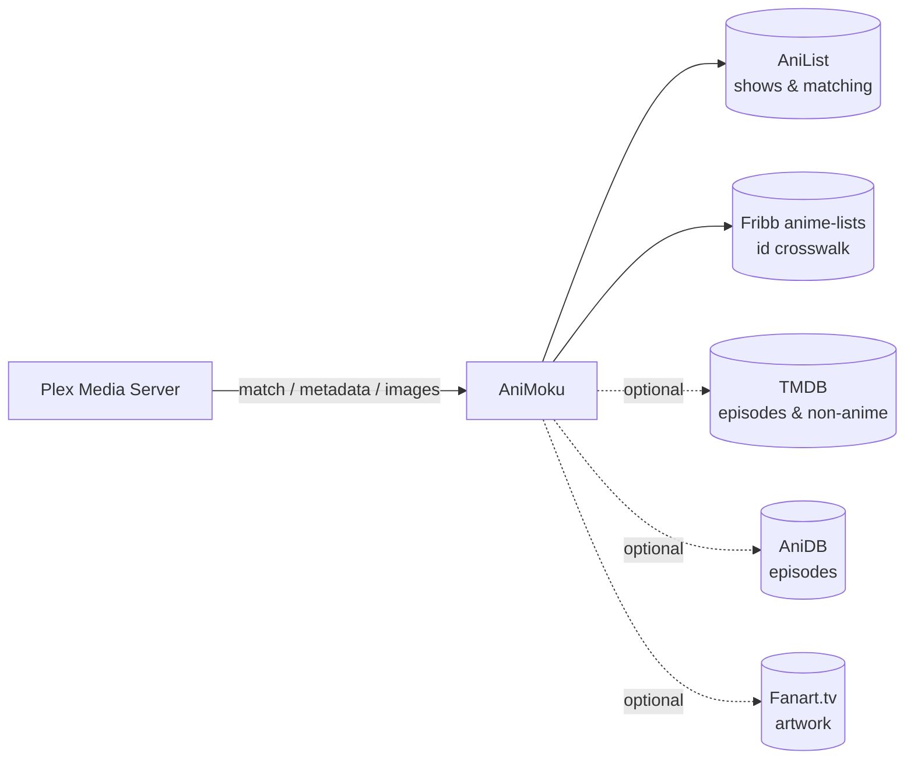

<div align="center">

<picture>
  <source media="(prefers-color-scheme: dark)" srcset="docs/assets/logo-dark.svg">
  
</picture>

**The anime metadata provider for Plex's new agents, self-hosted.**

AniList matching · TVDB-aligned seasons · real episode titles from TMDB & AniDB · extra artwork from Fanart.tv

[](LICENSE)
[](package.json)
[](https://github.com/VincentVS/AniMoku/pkgs/container/animoku)
[](#-connect-it-to-plex)

[Quick start](#-quick-start) · [Connect to Plex](#-connect-it-to-plex) · [Configuration](docs/configuration.md) · [How it works](docs/how-it-works.md) · [API](docs/api.md)

</div>

---

## Why

Plex's built-in agents number anime the way Western TV databases do, and HAMA no longer works with the new Plex agent framework. AniList knows anime best, but it treats every cour as a separate entry and has almost no episode titles.

**AniMoku** (from 目録 *mokuroku*, "catalogue") sits between Plex and several sources and gives Plex what it expects: one show, seasons numbered the way your files are, and real titles and summaries for every episode.

## ✨ Features

| | |
| --- | --- |
| 🎯 **Smart matching** | AniList search scored against English, romaji and native titles. Understands release filenames (`[Group] Show - 05 [1080p].mkv`, `S02E05`, dated episodes) and folder tags such as `{tvdb-267440}` or `[anilist-15125]`. |
| 🗂️ **Seasons that match your files** | Split cours are merged into TVDB seasons (`S03E13`), the numbering Sonarr and Jellyfin use. Prefer one long run? Use the [absolute order](docs/how-it-works.md#absolute-episode-order) (`S01E103`), globally or per show. |
| 📝 **Real episode metadata** | Titles, summaries, air dates and stills from TMDB (in your library's language) and AniDB, with AniList as the fallback. |
| 🖼️ **Richer artwork** | Per-season posters, backgrounds, clear logos and square art from Fanart.tv and TMDB. |
| 📺 **Not only anime** | With TMDB enabled, Western cartoons and live-action shows match too, all from one agent. |
| 🛡️ **A good API citizen** | Throttled queues, retry with backoff and in-memory caching for AniList. A persistent disk cache and ban protection for AniDB. |
| 🔗 **Plays well with others** | Exposes `tvdb://`, `tmdb://` and `imdb://` guids, so Trakt, Kometa and JellyPlex-Watched can recognise your shows. |

All optional sources are **opt-in**. With no API keys at all, it runs on AniList alone.

## 🚀 Quick start

The image is published to `ghcr.io/vincentvs/animoku` for amd64 and arm64.

```bash
mkdir animoku && cd animoku
curl -fsSLO https://raw.githubusercontent.com/VincentVS/AniMoku/main/docker-compose.yml
curl -fsSL https://raw.githubusercontent.com/VincentVS/AniMoku/main/.env.example -o .env
                              # optional: add TMDB / Fanart.tv / AniDB credentials to .env
mkdir -p data                 # persistent cache, must be writable by PUID:PGID (default 1000:1000)
docker compose up -d
```

Check that it's up:

```bash
curl http://localhost:3000/health
# {"status":"ok"}
```

<details>
<summary>Without Docker</summary>

Requires Node.js 20 or newer.

```bash
npm ci
npm start        # listens on PORT (default 3000)
npm test         # runs the test suite
```

</details>

## 🔌 Connect it to Plex

Requires **Plex Media Server 1.43** or newer, and Plex must be able to reach the provider over HTTP.

1. In Plex Web, open **Settings → Metadata Agents** and add a provider with the URL `http://<host>:3000`.
   If Plex runs in Docker on the same network, use the service name instead: `http://animoku:3000`.
2. Select the new agent, **AniMoku**, for your anime TV library (*Edit library → Advanced*).
3. Run **Refresh All Metadata** on the library.

> [!TIP]
> To pin a show to a specific entry, add an id tag to its folder name: `Frieren (2023) {anilist-154587}`.
> To use one long episode run for a single show, add `[absolute]`: `One Piece [absolute]`.

## ⚙️ Configuration

Configuration is done through environment variables. Everything is optional.

| Variable | What it enables |
| --- | --- |
| `TMDB_API_KEY` or `TMDB_ACCESS_TOKEN` | Localised episode titles and summaries, non-anime matching, the TMDB artwork gallery |
| `FANART_API_KEY` | Extra posters, backgrounds, clear logos and per-season art |
| `ANIDB_CLIENT` + `ANIDB_CLIENTVER` | AniDB episode titles in many languages, summaries and air dates |
| `EPISODE_ORDER` | `tvdb` (default) or `absolute` |
| `TITLE_LANGUAGE_ORDER` | Show title priority, default `english,romaji,native` |

See **[docs/configuration.md](docs/configuration.md)** for the complete list, defaults and deployment recipes.

## 🧭 How it works



AniList is the source for matching and show data. The [Fribb/anime-lists](https://github.com/Fribb/anime-lists) crosswalk maps each AniList entry to its TVDB season, which is how split cours are merged. TMDB and AniDB fill in episode titles and summaries, and Fanart.tv adds artwork.

The full story, including season layout rules, the field priority per source, caching and rate limiting, is in **[docs/how-it-works.md](docs/how-it-works.md)**.

## 🔒 Security

The provider has **no authentication**, because Plex's metadata provider protocol doesn't define any. Keep it on your LAN or on a private Docker network with Plex, and **don't expose it to the internet**: anyone who can reach it can spend your TMDB, Fanart.tv and AniDB quotas. See [SECURITY.md](SECURITY.md) for how to report a vulnerability.

## 🤝 Contributing

Issues and pull requests are welcome. Please run `npm test` before opening a PR. A [Bruno](https://www.usebruno.com/) collection in [`bruno/`](bruno) has ready-made requests for every endpoint.

## 🙏 Acknowledgements

- [AniList](https://anilist.co), [TMDB](https://www.themoviedb.org), [AniDB](https://anidb.net) and [Fanart.tv](https://fanart.tv) for their data and APIs. This product uses the TMDB API but is not endorsed or certified by TMDB.
- [Fribb/anime-lists](https://github.com/Fribb/anime-lists) for the id crosswalk.
- [plexinc/tmdb-example-provider](https://github.com/plexinc/tmdb-example-provider), the reference implementation of the Plex metadata provider protocol.
- [HAMA](https://github.com/ZeroQI/Hama.bundle), which showed how anime in Plex should look.

## 📄 License

[MIT](LICENSE). This project is not affiliated with Plex, AniList, TMDB, AniDB or Fanart.tv. Logo and brand assets: [docs/brand.md](docs/brand.md).
